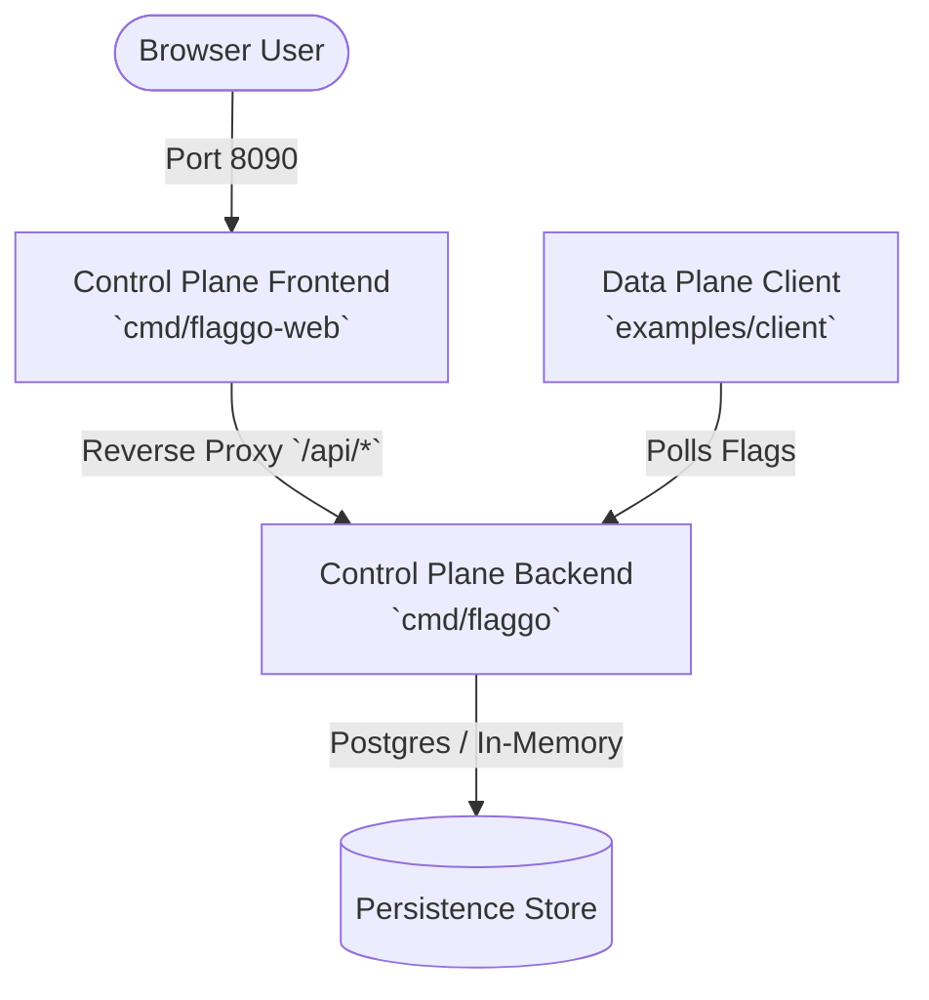

# Architecture Overview

Flaggo is a lightweight, self-hosted feature flag platform designed to decouple software deployment from feature release. The system separates centralized management from client-side evaluation, enabling rapid rollout adjustments, percentage-based targeting, and instant kill switches without requiring client restarts or redeployments.

## System Components

Flaggo is organized around three primary binaries within a single Go module (`github.com/xarop-pa-toss/flaggo`), supported by optional relational persistence [repo://go.mod#L1-L3, repo://README.md]:

- **Control Plane Backend** (`cmd/flaggo`): Exposes the core REST API for feature flag CRUD operations, kill switches, and rollout percentage configurations. It handles health and readiness checks, emits Prometheus metrics, supports graceful shutdown, and abstracts persistence behind a pluggable storage interface [repo://cmd/flaggo/main.go, repo://README.md].
- **Control Plane Frontend** (`cmd/flaggo-web`): Serves the management dashboard UI and acts as an API gateway that reverse-proxies `/api/*` requests to the backend. In containerized deployments, it is the sole service that publishes a host port [repo://cmd/flaggo-web/main.go].
- **Data Plane Client** (`examples/client`): Represents consuming applications. It periodically polls the backend API for flag definitions and evaluates feature states locally in memory per user key, printing real-time state transitions [repo://README.md, repo://examples/client/main.go].
- **Postgres Store** (Optional): Provides durable relational storage. When configured via `STORE=memory`, the backend runs entirely in-memory, eliminating database dependencies for local development and testing [repo://cmd/flaggo/main.go, repo://README.md].

## Monorepo & Internal Package Layout

The repository is structured as a single Go module with shared packages under `internal/`:

- `internal/config`: Environment variable loading and validation using 12-factor configuration principles.
- `internal/http`: Backend REST API routers, flag handlers, and health probe endpoints.
- `internal/web`: Frontend dashboard templates/assets and HTTP reverse proxy logic.
- `internal/store`: Pluggable storage abstraction (`store.Store` interface) supporting both in-memory maps and Postgres database backends with automatic schema migration [repo://cmd/flaggo/main.go].
- `internal/model`: Core domain entities (feature flags, rollout settings, audit structures).
- `internal/eval`: Deterministic client-side flag evaluation rules (kill switches, boolean states, and hash-based rollout percentages) [repo://README.md].
- `internal/observability`: Prometheus metrics and structured logging (`log/slog`).

## Runtime Topology & Isolation

Services communicate over structured HTTP contracts and internal network routing:
- **`backend`**: Processes REST API requests, maintains flag states via storage backends, and listens internally on port 8080 [repo://cmd/flaggo/main.go].
- **`frontend`**: Exposes management ports to the host machine, proxying browser traffic (`/api/*`) to the backend [repo://cmd/flaggo-web/main.go, repo://README.md].
- **`client`**: Polls the backend API endpoint to synchronize flag states for local evaluation [repo://README.md, repo://examples/client/main.go].

## Key Architectural Principles

1. **Client-Side Evaluation**: Flag evaluation happens within client applications rather than on every server request. Clients cache flags in memory and poll for updates at configured intervals (e.g., every 2 seconds), minimizing control plane load and ensuring low-latency flag decisions [repo://README.md].
2. **Deterministic Rollouts**: Rollout percentages use a deterministic hash combining the flag name and user key. This ensures consistent user experience across requests without requiring centralized session tracking [repo://README.md].
3. **Graceful Degradation**: Storage is accessed via the `store.Store` interface. If Postgres is unavailable or unconfigured in memory mode, the backend can start in a degraded readiness state (`readyz` reports unready) while still servicing liveness probes [repo://cmd/flaggo/main.go].
4. **Command Submodels**: Binaries support subcommands (`serve`, `healthcheck`, `version`) to support container lifecycle probes and operational tooling [repo://README.md].

## Related Pages

- [Request Flow](request-flow.md)
- [Quickstart](../quickstart.md)
