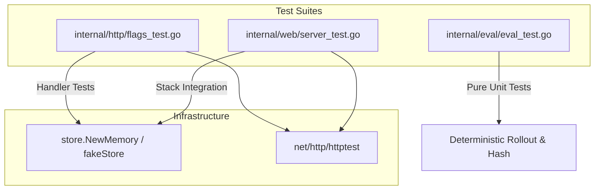

# Testing Strategy

## Responsibility

Tests live next to code (`*_test.go`) and run with `STORE=memory` so no
Postgres database is required for unit, handler, or integration test suites.
CI runs `go test -v ./...` and `go vet ./...` alongside binary compilation checks.

## Test Files and Scope

- **`internal/eval/eval_test.go`**: Pure unit tests covering feature flag evaluation logic including kill switches, disabled flags, rollout percentages (0%, 100%, and intermediate distributions), and determinism of `Evaluate` [repo://internal/eval/eval_test.go].
- **`internal/http/flags_test.go`**: HTTP handler and CRUD tests using in-memory mock stores and `httptest.NewRequest`/`httptest.NewRecorder` to verify endpoints, validation, and error paths [repo://internal/http/flags_test.go].
- **`internal/web/server_test.go`**: Gateway and dashboard integration tests (`newStack`) that spin up an in-process Control Plane API wired to a frontend proxy using `store.NewMemory()` [repo://internal/web/server_test.go].

## Approach and Invariants

- **No external dependencies**: Handler and evaluation tests use in-memory stores (`store.NewMemory()` or `fakeStore`), allowing fast parallel test execution without Postgres [repo://.github/workflows/ci.yml, repo://internal/http/flags_test.go, repo://internal/web/server_test.go].
- **HTTP test harnesses**: Uses `net/http/httptest` recorders and servers for HTTP-level assertions and proxy routing.
- **Pure evaluation**: Evaluation tests run as pure functions with zero I/O overhead.
- **CI Pipeline Verification**: CI runs `go vet ./...`, `go test -v ./...` with `STORE=memory`, and compiles all binaries (`cmd/flaggo`, `cmd/flaggo-web`, and `examples/client`) [repo://.github/workflows/ci.yml].

## Test Gaps & Future Work

- Integration test suite against a real PostgreSQL instance.
- End-to-end testing of the polling client daemon.
- Load, stress, and soak test suites.

## Related

- [Control Plane API](../api/control-plane-api.md)
- [Flag Evaluation](../evaluation/flag-evaluation.md)
- [Storage Layer](../storage/storage-layer.md)
- [CI Pipeline](../build/ci-pipeline.md)
